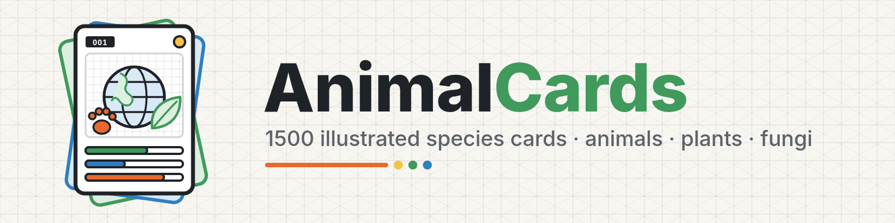

<p align="center">
  
</p>

<p align="center">
  <a href="README.zh-CN.md"><b>中文文档 (Chinese)</b></a> ·
  <a href="CARDS.md">Card index</a> ·
  <a href="REVIEW_CHECKLIST.md">Review checklist</a> /
  <a href="%E5%BE%85%E6%A0%B8%E6%B8%85%E5%8D%95.md">待核清单</a> ·
  <a href="webapp/README.md">3D globe web app</a>
</p>

# AnimalCards

**1000 printable, bilingual (Chinese/English) species cards — animals, plants and fungi — drawn in a clean grid-line isometric style.**

## Overview

AnimalCards is a set of one-species-per-card illustrated fact cards, laid out like a portrait trading card. Each card combines an original isometric line illustration with real, sourced data: names, IUCN Red List status, four data bars, two "skills", a short introduction, a fun fact and the species' range. The card text is in Chinese (with English and scientific names on every card). They are meant for kids, classrooms and science-communication posters.

- **1000 cards**: 760 animals, 200 plants, 40 fungi, in 16 categories
- Every card is a **1080×1920 PNG (rendered at 2×)** plus a **single-page PDF**
- An interactive **3D globe web app** ([`webapp/`](webapp/README.md)) places every card on the map where the species lives or comes from
- Everything is regenerated from JSON data files in [`tools/data/`](tools/data/)

## What each card shows

| Part | Content |
|---|---|
| Header | Card number, Chinese name, English name and *scientific name* |
| Tags | Habitat type (land / water / sky / amphibious / plant / aquatic plant / desert plant / fungus) and diet. Plants and fungi use autotroph / insectivorous / saprotroph / symbiont / parasite / fermenter instead of a diet |
| IUCN badge | Red List category and assessment year where one exists. Species with no assessment, domestic animals, cultivated plants and microbes are labelled “not evaluated” (NE) |
| Illustration | Original isometric line art on a light grid. Illustrations are schematic and not to scale |
| 4 data bars | Body data for animals (length, weight, lifespan, speed …). Plants and fungi get plant- or fungus-specific measures (height, leaf length, flower or cap diameter, yield, growth temperature, altitude …). The solid part runs from 0 to the low value and the striped part shows the usual range. Size uses log scales, everything else linear. The scales are printed on the card |
| 2 skills | Real abilities only (e.g. echolocation, nitrogen fixation, carnivory, bioluminescence, mycorrhiza) |
| Text | 3-sentence introduction, a fun fact, and the range |
| Safety notes | Red “safety” box for venomous, poisonous or easily mistaken species. **Every mushroom card warns: never eat wild mushrooms** |
| Footer | Data caveats (e.g. sexes combined, wild vs. captive lifespan) and the list of sources used |

Data conventions: `约` = approximate, `*` = genus- or group-level data rather than this species, `待核` = to be verified (see [Review checklist](REVIEW_CHECKLIST.md)).

## Categories

| Kingdom | Category | 中文 | Cards | Card numbers |
|---|---|---|---:|---|
| Animals | Pets | 宠物 | 95 | 002, 007–016, 106–144, 401–445 |
| Animals | Farm | 农场 | 95 | 017–026, 145–184, 446–490 |
| Animals | Grasslands & Highlands | 高原草原 | 95 | 003, 006, 027–042, 185–216, 491–535 |
| Animals | Forest | 森林 | 95 | 001, 043–056, 217–251, 536–580 |
| Animals | Ocean | 海洋 | 95 | 005, 057–071, 252–285, 581–625 |
| Animals | Birds | 鸟类 | 95 | 004, 072–084, 286–321, 626–670 |
| Animals | Reptiles & Amphibians | 爬行两栖 | 95 | 085–095, 322–360, 671–715 |
| Animals | Insects | 昆虫 | 95 | 096–105, 361–400, 716–760 |
| Plants | Flowers | 花卉 | 40 | 761–800 |
| Plants | Trees | 树木 | 40 | 801–840 |
| Plants | Crops | 农作物 | 35 | 841–875 |
| Plants | Fruits & Vegetables | 水果蔬菜 | 45 | 876–920 |
| Plants | Desert plants | 沙漠植物 | 20 | 921–940 |
| Plants | Aquatic plants | 水生植物 | 20 | 941–960 |
| Fungi | Mushrooms | 蘑菇 | 30 | 961–990 |
| Fungi | Molds & Yeasts | 霉菌酵母 | 10 | 991–1000 |
| | **Total** | | **1000** | 760 animals · 200 plants · 40 fungi |

Animal cards were added in several rounds, so each animal category spans several number ranges. The full list of all 1000 cards, with English names, Chinese names, scientific names, IUCN status and PNG/PDF links, is in **[CARDS.md](CARDS.md)** ([中文版](CARDS.zh-CN.md)).

## Repository layout

```
AnimalCards/
├── 动物/<category>/<name>.png|.pdf   animal cards (animals)
├── 植物/<category>/<name>.png|.pdf   plant cards (plants)
├── 真菌/<category>/<name>.png|.pdf   fungus cards (fungi)
├── tools/
│   ├── data/<id>.json        card data: one file per card, the source of truth
│   ├── card.html.j2          card template (HTML/CSS, rendered with headless Chrome)
│   ├── render_card.py        renders data + art → PNG/PDF (into tools/out/)
│   ├── art*.py, iso.py, icons.py   illustration and icon code (SVG)
│   ├── cards/                scripts that wrote the data files, batch by batch
│   └── sheet.py, preview*.py  contact sheets / previews for visual checks
├── webapp/                   3D globe web app (FastAPI + globe.gl) → webapp/README.md
├── assets/                   project logo (logo.svg, banner.svg, PNG exports, make_logo.py)
├── CARDS.md / CARDS.zh-CN.md          index of all 1000 cards
├── REVIEW_CHECKLIST.md / 待核清单.md   items that still need human verification
└── README.md / README.zh-CN.md
```

Folder and file names are in Chinese (e.g. `动物/海洋/蓝鲸.png`). The links in [CARDS.md](CARDS.md) are URL-encoded, so they work on GitHub.

## 3D globe web app

[`webapp/`](webapp/) puts all 1000 cards on a draggable 3D globe, with one to three markers per species. You can filter by kingdom, category and IUCN status, and search by Chinese, English or scientific name. Click a marker to preview the card, open the full PNG or download the PDF. The UI is Chinese, with an English/中文 toggle. Map positions are **approximate representative points** derived from each card's range text. See **[webapp/README.md](webapp/README.md)** for local setup, the API, Docker/systemd deploy, and **Kubernetes one-shot deploy** (`./webapp/deploy/k8s/deploy.sh`).

## Data sources and licences

- **Card data** comes from public sources: the English Wikipedia article for each species (Chinese Wikipedia for some Chinese names and plant details), the **IUCN Red List** (category and assessment year), and for some cards FishBase / SeaLifeBase, Flora of China (eFloras), Animal Diversity Web, NatureServe, Smithsonian's National Zoo, DAD-IS (FAO) and redlist.info. Each card lists its sources in the footer, and the same list is in `sources` in `tools/data/<id>.json`.
- The text is short, original summaries, not copied passages. Wikipedia content is licensed CC BY-SA, and IUCN Red List data is subject to the [IUCN terms of use](https://www.iucnredlist.org/terms/terms-of-use). Please credit those sources when you reuse the data.
- **Illustrations, card design and logo** are original artwork made for this project (generated from code in `tools/` and `assets/`).
- **Web app third-party components** (globe.gl, three.js, NASA Blue Marble textures, Natural Earth) and their licences are listed in [webapp/README.md](webapp/README.md#third-party-assets-and-licences).
- The repository does not yet have a LICENSE file. Until one is added, ask the repository owner before reusing the cards beyond personal or classroom use.

## Accuracy and review

These cards were made **with AI assistance** and **need human review** before you use them for teaching or printing. Only data that could be found in a public source was used, and nothing was invented. Where a source was unclear, contradictory, or only covered a related group, the card says so (`待核`, `*`, or a footnote).

All of these items are collected in a tickable checklist:

- **[REVIEW_CHECKLIST.md](REVIEW_CHECKLIST.md)**: English
- **[待核清单.md](%E5%BE%85%E6%A0%B8%E6%B8%85%E5%8D%95.md)**: Chinese original

It currently lists 886 card items across 635 cards (unverified diets, IUCN status or year, group-level data, single-source claims, bars outside their scale …) and 238 web-map location items.

## Contributing and regenerating cards

1. Edit or add a data file in `tools/data/<id>.json`. New species also need an illustration function in one of `tools/art*.py` (registered in `art.ART`).
2. Render. You need Python 3.10+, Playwright, Google Chrome at `/usr/bin/google-chrome`, Jinja2, Pillow and the Noto Sans CJK / Noto Serif CJK fonts:
   ```bash
   pip install playwright jinja2 pillow markupsafe
   python tools/render_card.py <id> [<id> …]    # no ids = render all; --no-pdf to skip PDFs
   ```
   Output goes to `tools/out/<name>.png|pdf`. The renderer reports clipped text and missing glyphs. Copy the files into `动物|植物|真菌/<category>/`.
3. Update the web app data and thumbnails (`webapp/scripts/build_data.py`, `build_thumbs.py`). See [webapp/README.md](webapp/README.md).
4. Update [CARDS.md](CARDS.md), [CARDS.zh-CN.md](CARDS.zh-CN.md) and both READMEs if counts change. If you resolve an item in [REVIEW_CHECKLIST.md](REVIEW_CHECKLIST.md) or [待核清单.md](%E5%BE%85%E6%A0%B8%E6%B8%85%E5%8D%95.md), tick it off.

Corrections with a source link are very welcome. Please open an issue or pull request.

## Disclaimer

AnimalCards is an educational project. The data may contain errors or be out of date, and conservation statuses change. Map locations are approximate. Safety notes on venomous, poisonous or edible-looking species are general reminders, not medical or foraging advice. **Never eat wild mushrooms or plants based on these cards.** In case of a bite, sting or poisoning, contact a doctor or poison-control centre immediately.
