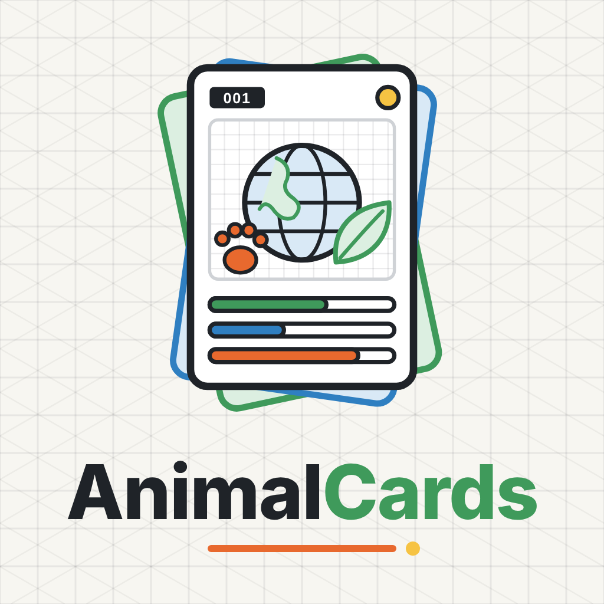

<a href="README.md">English</a> · <b>中文</b> · <a href="CARDS.zh-CN.md">卡片列表</a> · <a href="%E5%BE%85%E6%A0%B8%E6%B8%85%E5%8D%95.md">待核清单</a> · <a href="webapp/README.zh-CN.md">3D 地球网页版</a>

# AnimalCards · 常见动物卡

一张卡一个物种（动物、植物、真菌），仿宝可梦卡牌的竖版布局，沿用 OrangeSTEM 海报的 v4 网格线 + 等轴线稿风格。

> 人工复核：见 [待核清单.md](%E5%BE%85%E6%A0%B8%E6%B8%85%E5%8D%95.md)（英文版 [REVIEW_CHECKLIST.md](REVIEW_CHECKLIST.md)）。

## 卡片列表

共 1000 张（动物 760；植物 200；真菌 40）。分类：宠物 95，农场 95，高原草原 95，森林 95，海洋 95，鸟类 95，爬行两栖 95，昆虫 95，花卉 40，树木 40，农作物 35，水果蔬菜 45，沙漠植物 20，水生植物 20，蘑菇 30，霉菌酵母 10。

全部 1000 张卡片的列表（编号、名字、学名、IUCN、PNG/PDF 链接）见 **[CARDS.zh-CN.md](CARDS.zh-CN.md)**（英文版：[CARDS.md](CARDS.md)）。

## 说明

- **风格**：1080×1920 竖版卡，浅网格背景、细线等轴插画，颜色只用墨色 + 类型色（陆地绿 / 水中蓝 / 天空青 / 两栖青绿；植物、水生植物、沙漠植物、菌类各有自己的类型色）+ 橙、黄两种点缀色。每张卡都输出 PNG（2× 分辨率）和单页 PDF。
- **卡片内容**：中英文名 + 拉丁学名、栖息类型和食性标签、IUCN 红色名录等级徽章、4 条“身体数据”条、2 个技能、3 句简介、冷知识和分布。
- **植物和真菌卡**（No.761–1000）：数据条换成适合植物/真菌的指标（株高、叶长、花径、菌盖径、产量、生长温度、海拔等）；技能只写真实的能力（如固氮、捕虫、发光、菌根共生）；食性标签改为自养 / 食虫 / 腐生 / 共生 / 寄生 / 发酵。没有 IUCN 评估的标“未评估”，并注明栽培植物 / 栽培食用菌 / 微生物。有毒或容易误食的物种有红色“安全”提示；**所有蘑菇卡都提醒：不要采食野生蘑菇**。数据口径是属级或群体数据时在数值后标 `*`。
- **数据条**：只用查得到的真实数据。实心段是 0 到下限，条纹段是常见范围；体重、体长用对数刻度，其余用线性刻度。近似值标“约”，口径（如雌雄合并、野外寿命）写在卡底注释里。
- **数据来源**：英文 Wikipedia 对应条目，IUCN 红色名录（等级和评估年份），部分卡片另用 Smithsonian's National Zoo 等动物园或机构资料；植物另用中文维基百科和 Flora of China（eFloras），真菌的 IUCN 等级通过 IUCN 红色名录 / redlist.info 查询。每张卡的底部都列出了它用到的来源。
- **插画**：插画是示意图，不按真实比例。
- **审核**：卡片由 AI 辅助制作，数据和文字**需要人工审核**后再用于教学或印刷。所有标“待核”、`*` 的数据、数据缺口和网页地图位置问题已汇总在 **[待核清单.md](%E5%BE%85%E6%A0%B8%E6%B8%85%E5%8D%95.md)**（带勾选框，可逐条核对）。
- **重新生成**：`tools/` 里有模板和脚本。`tools/data/*.json` 存数据，`art.py` 画插画，运行 `python tools/render_card.py` 即可（需要 Playwright + Chrome、Jinja2 和 Noto Sans CJK 字体）。

## 3D 地球网页版

`webapp/` 里有一个网页应用：在 3D 地球上按分布地标注全部 1000 张卡片（动物、植物、真菌，可按界和类别筛选），点击标注即可查看卡片、下载 PDF。本地运行和服务器部署方法见 [webapp/README.zh-CN.md](webapp/README.zh-CN.md)。地图上的位置都是近似点，需要人工复核。
